# 채묵: 잃어버린 색 (mukdong-ink)

> 먹으로 그린 세상, 색은 검법과 물들인 천에만 남았다.

화선지 위에 먹으로 그린 세상을 큰 붓 한 자루로 베어 나가는 수묵화 멀티플레이 RPG입니다.
월드는 흑백이고, 색은 플레이어가 펼치는 검법과 염색한 장비에만 있습니다. 그래서 같은 사냥터의 다른 플레이어가
기술을 쓰면 회색 들판 위로 색이 번쩍이는 게 멀리서도 보입니다.
Verse8(Agent8) 플랫폼용으로 만들었고, 설치 없이 PC와 모바일(가로) 브라우저에서 돌아갑니다.

**▶ 플레이: https://verse8.io/dl/games/S5X3M5t?referral=RCNU6B**

<p>
  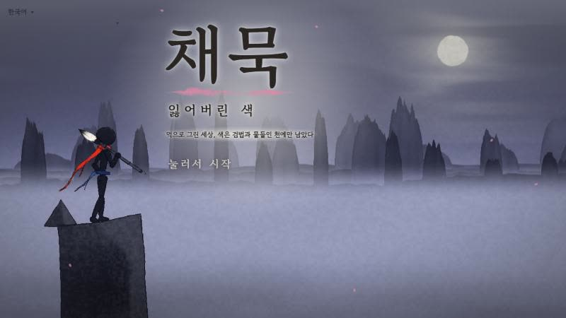
</p>

<p>
  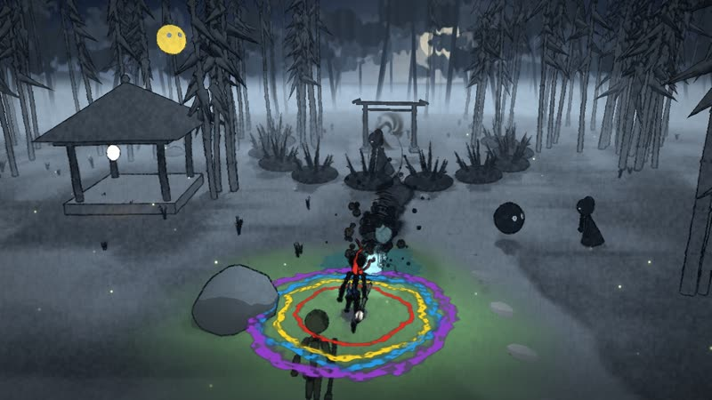
  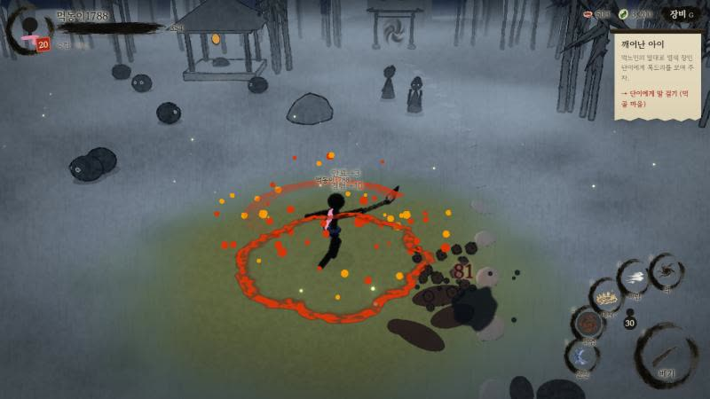
</p>

## 어떤 게임인가

- **세계:** 서른 해 전 '번짐'이 첫 붓 오방붓을 부러뜨리고 세상의 색을 마셨습니다. 주인공은 먹방울에서 태어났는데
  목에 감긴 천에만 분홍빛이 남아 있는 아이입니다. 정해진 이름은 없고 NPC들이 플레이어의 닉네임으로 부릅니다.
- **지역:** 먹골 마을에서 시작해 죽림 → 연못가 → 먹봉우리(보스 대먹귀)를 지나 두 번째 마을 솔재로 넘어가고,
  옛 가마터 → 불탄 절터 → 향로 마당(보스 잿불귀)까지 이어집니다. 레벨은 1부터 35까지입니다.
- **전투:** 세 번 이어 베기(마지막은 회전 베기), 공중 회전, 구르기, 대시 베기에 오방 검법 다섯 가지를 레벨에 따라
  배웁니다. 물결베기 · 화염선풍 · 대지낙하 · 바람질주 · 먹감옥이고, 기술마다 제 색이 있습니다.
- **궁극기 「무지개 붓질」:** 몬스터를 베고 쓰러뜨리면 게이지가 찹니다. 다 차면 높이 떠올라 몸을 돌리며 무지개 고리를
  그린 뒤 내려꽂고, 주변의 적은 자기가 있던 방향의 무지개 색으로 흩어집니다. 1레벨부터 쓸 수 있습니다.
- **멀티플레이:** 지역마다 채널이 10개, 채널마다 최대 15명입니다. 같은 채널 사람들의 이동, 기술, 궁극기가 그대로 보이고
  채팅을 할 수 있습니다.

<p>
  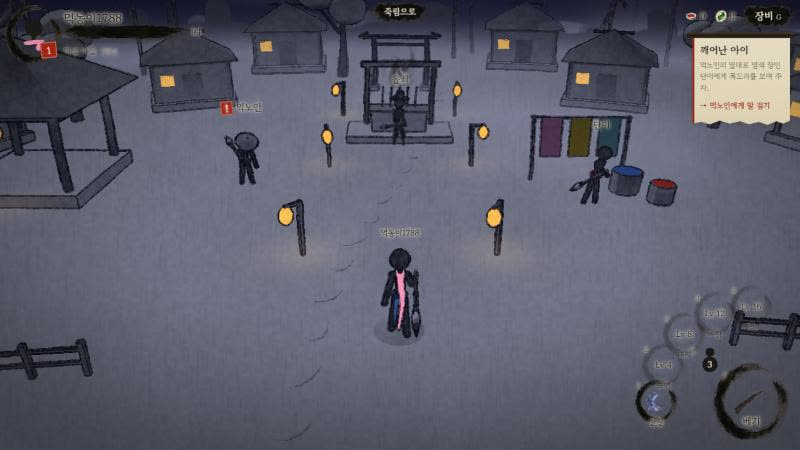
  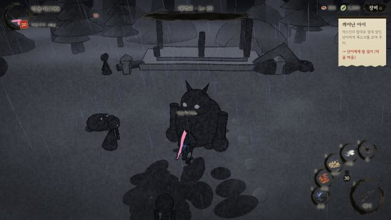
</p>

## 주요 기능

**성장과 장비**
- 레벨, 검법 수련 포인트, 붓 · 칼 · 갓 · 띠 장비와 강화(먹돌 · 색 조각).
- 염색: 몬스터에게서 얻는 안료로 장비를 물들입니다. 3D 월드에서 색이 보이는 곳은 기술과 이 천뿐입니다.
- 병기 제단 뽑기: 확률을 공개하고, 천장이 있습니다. 같은 장비가 겹치면 강화 재료로 바뀝니다.
- 몬스터 도감, 랭킹.

**퀘스트와 길 찾기**
- 본편(이야기), 오늘의 의뢰(매일 초기화), 지역 의뢰(사냥터마다 반복). 본편에 필요한 경지가 모자라면
  추적창이 알려 주고, 자동 진행이 의뢰를 먼저 돌고 돌아옵니다.
- 구석 미니맵과 펼친 지도. 지도에는 지역 연결도, 지역별 몬스터와 레벨 · 드랍, NPC가 나오고, 두 마을 사이는
  순간이동으로 오갑니다.
- 자동 사냥: 물약, 궁극기 자동 사용을 따로 켜고 끌 수 있습니다.

**모바일과 언어**
- 왼쪽 스틱과 공격 버튼 둘레의 기술 버튼. PC와 같은 전투를 터치로 합니다.
- 한국어 · English · 日本語 · 繁體中文 · 简体中文.
- 광고는 버튼을 눌렀을 때 보는 리워드 광고만 있고 전면 광고는 없습니다.

<p>
  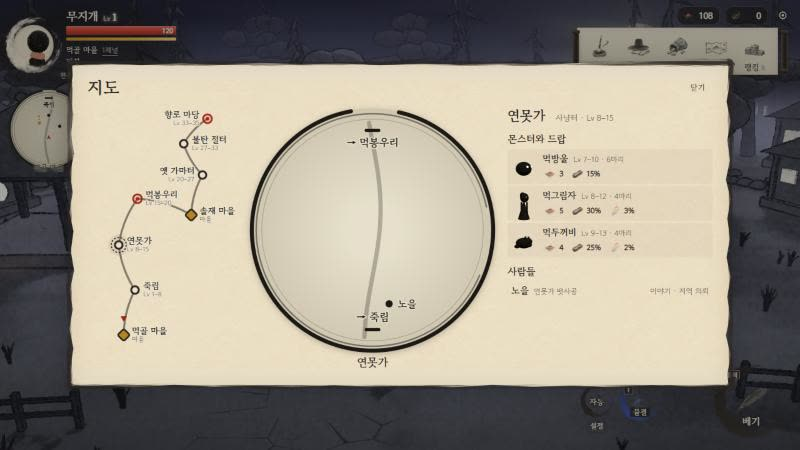
  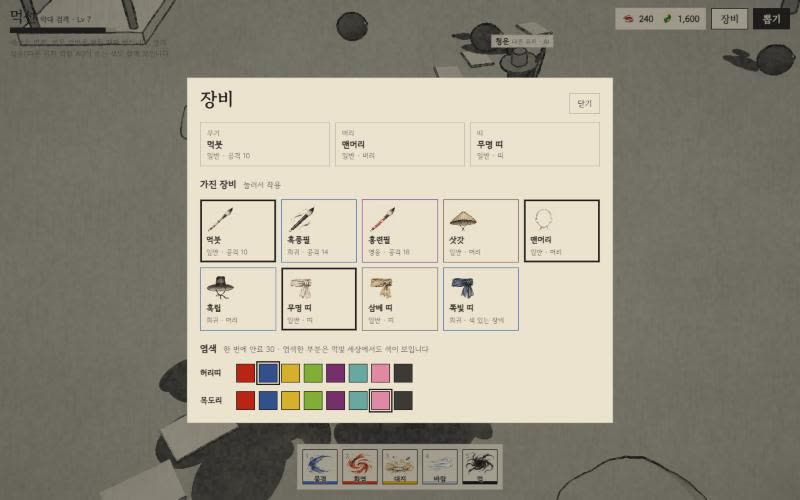
</p>

## 지역

<p>
  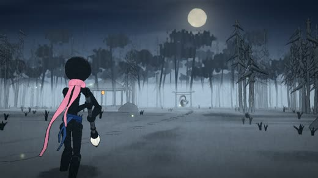
  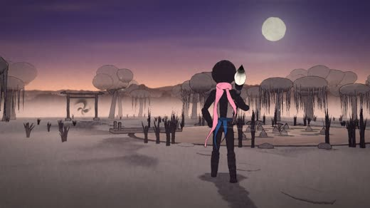
  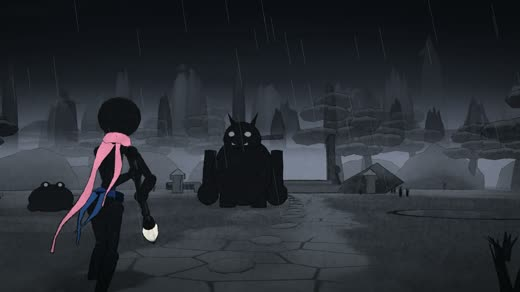
</p>
<p>
  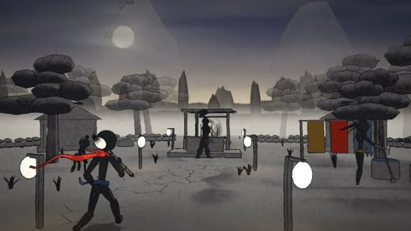
  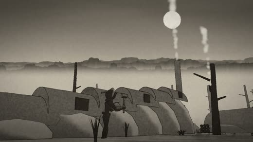
  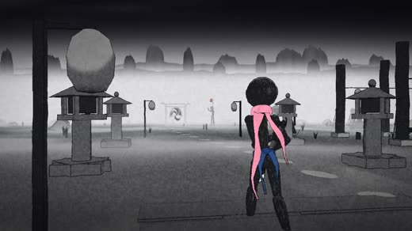
</p>

| 지역 | 종류 | 레벨 |
|---|---|---|
| 먹골 마을 | 마을 (먹노인 · 염색 장인 · 병기 제단) | |
| 죽림 | 사냥터 | 1–8 |
| 연못가 | 사냥터 | 8–15 |
| 먹봉우리 | 사냥터, 보스 대먹귀 | 15–20 |
| 솔재 마을 | 두 번째 마을 (산할미 · 여울 · 무쇠) | |
| 옛 가마터 | 사냥터 | 20–27 |
| 불탄 절터 | 사냥터 | 27–33 |
| 향로 마당 | 보스 잿불귀 | 33–35 |

## 기술 스택

| 영역 | 사용 기술 |
|---|---|
| 클라이언트 | TypeScript, Vite 8, DOM UI (프레임워크 없음) |
| 렌더링 | three.js 0.185, 먹 후처리 패스(깊이 · 노멀 외곽선, 단계 나눈 농담, 종이 결) |
| 서버 | Verse8 Agent8 Game Server (`server/src/server.ts`: 지역 × 채널 방, 전투 판정, 진행도, 뽑기, 랭킹) |
| 플랫폼 | `@agent8/gameserver`, `@verse8/platform`(VX Shop), `@verse8/ads`(리워드 광고) |
| 테스트 | Vitest (클라이언트), 서버 테스트 20개 파일 |

## 구조에서 신경 쓴 것

**흑백 세상에 색만 남기는 렌더링**
장면을 평소대로 그린 뒤 먹 패스가 깊이와 노멀로 외곽선을 긋고, 밝기를 몇 단계로 나눠 먹의 농담처럼 칠하고, 종이 결을
얹습니다. 염색한 재질은 장면 버퍼의 알파에 표시를 남겨서 먹 패스가 그 색을 지우지 않습니다. 기술 이펙트는 먹 패스
뒤에 따로 그려 원래 색 그대로 보이고, 기술 주변으로 잠깐 세상의 본래 색이 비쳐 보입니다.

**판정은 서버, 연출은 클라이언트**
공격 판정, 피해, 처치 보상, 궁극기 게이지는 서버가 방 잠금(`$lock`) 안에서 계산합니다. 클라이언트는 자세와 기술
번호만 보내고, 다른 플레이어 화면에서는 그 자세로 같은 동작을 다시 그립니다. 계정은 인자가 아니라 접속 계정으로
정하고, 구매 지급은 영수증 단위로 한 번만 처리합니다.

**공유 코드는 순수하게**
`src/shared/`는 클라이언트와 서버가 같이 씁니다. 서버 샌드박스에서 돌아야 하므로 DOM, three.js, 모듈 부수효과가
없고, 난수는 인자로 받습니다.

**서버 없이 실행하기**
`npm run dev:offline`은 실제 서버 코드를 브라우저 안에서 돌리고 세계 상태를 localStorage에 둡니다. 배포하지 않고
전체 게임을 혼자 해 볼 수 있습니다.

**다국어**
모든 화면 문자열은 한국어 원문을 키로 `t()`를 거칩니다. `npm run i18n:check`가 빠진 번역을 잡아냅니다.
한국어판에는 한자를 쓰지 않습니다(일본어 · 중국어판은 각 언어의 글자로 씁니다).

## 실행

```bash
npm install
npm run server:install
npm run dev:offline        # 서버 없이 브라우저 안에서 전부 실행
npx tsc -b                 # 타입 검사
npx vitest run             # 클라이언트 테스트
npm run server:test        # 서버 테스트
npm run i18n:check         # 번역 누락 검사
npx vite build             # 배포 빌드
```

`npm run dev`는 `.env`의 Verse8 서버에 붙습니다.

## 조작

| PC | 모바일 | 동작 |
|---|---|---|
| WASD / 방향키 | 왼쪽 스틱 | 이동 |
| 클릭 (누르고 있으면 이어 베기) | 베기 버튼 | 공격 |
| Space | 구르기 버튼 | 구르기 |
| 1–5 | 기술 버튼 | 오방 검법 |
| F | 무지개 버튼 | 궁극기 |
| Q | 물약 버튼 | 물약 |
| Z | 자동 버튼 | 자동 진행 |
| G | 대화 버튼 | NPC와 대화 |
| N | 미니맵 누르기 | 지도 |
| I / K / P / R / B | 상단 메뉴 | 장비 / 수련 / 도감 / 랭킹 / 상점 |
| Enter | 채팅 버튼 | 채팅 |

## 폴더

```
src/
  game/       game.ts(조립 · 메인 루프), actor(먹동이 동작), monsters, autoplay, quests, story, audio
    render/   gfx(먹 패스), fx(기술 이펙트), 리그 · 모션, 지역 분위기
    ui/       HUD, 미니맵 · 지도, 시트(장비 · 상점 · 뽑기), 대화, 터치 입력
    i18n/     en · ja · zh-Hant · zh-Hans 사전
  net/        서버 API, 오프라인용 로컬 서버
  shared/     클라이언트 · 서버 공용 규칙 (지역, 전투 수치, 성장, 장비, 이야기)
server/
  src/        게임 서버 (방 · 전투 · 진행도 · 상점 · 광고 검증)
  test/       서버 테스트
public/assets 음악 · 효과음 · 로딩 그림 · UI 이미지
docs/         설계(DESIGN.md), 이야기(STORY.md), 다국어(I18N.md), 개발 일지
```
